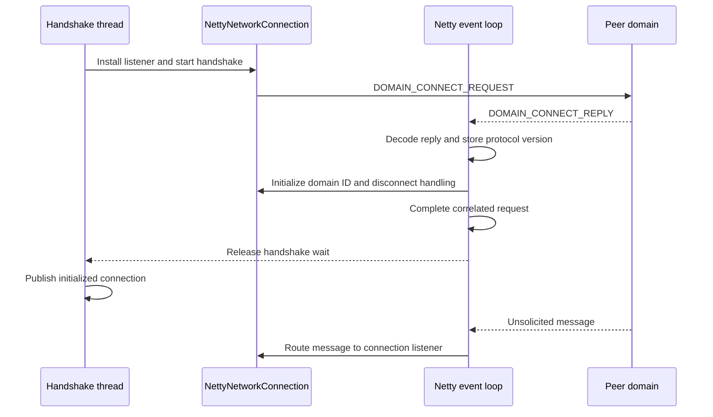

# Outbound handshake

Normal outbound and reverse outbound connections use the same domain-connect handshake after they establish a TCP channel. Normal outbound
opens the channel, while reverse outbound accepts a channel opened by a reverse inbound peer.

## Connection establishment

- Normal outbound opens the TCP channel and performs the handshake on the calling thread.
- Reverse outbound accepts the TCP channel and schedules the handshake using an executor. The handshake must not block the Netty event
  loop that decodes its reply. After the handshake completes, reverse outbound passes the initialized connection to the configured connection
  consumer, which adds it to the virtual network pool.

## Handshake sequence

The handshake establishes the peer domain ID and negotiated protocol version before the connection handles unsolicited messages.

1. `NettyNetworkConnection` registers itself as the outbound message listener with `CasualMessageHandler`. The connection receives read-only
   access to the protocol holder.
2. `NettyNetworkConnection` sends a `DOMAIN_CONNECT_REQUEST` that contains the supported protocol versions.
3. The peer selects a protocol version and sends a `DOMAIN_CONNECT_REPLY`.
4. `CasualNWMessageDecoder` decodes the reply and immediately stores the selected version in the channel's `ProtocolVersionValueHolder`.
5. `CasualMessageHandler` passes the peer domain ID to the listener before it completes the correlated request.
6. `NettyNetworkConnection` stores the peer domain ID. For protocol version 1.1 and later, it also installs domain-disconnect handling. The
   connection reads the selected protocol version from the holder and does not store a second copy.
7. Because `DOMAIN_CONNECT_REPLY` is a correlated response rather than an unsolicited message, `CasualMessageHandler` passes it to the
   correlator, which completes the handshake request.
8. The waiting handshake thread resumes and makes the initialized connection available to its consumer.

## Ordering guarantee

Netty processes inbound events serially for an individual channel. The decoder and message handler therefore finish the connect-reply steps
before the same channel handles a following frame. Other channels can perform their handshakes concurrently without changing this
per-channel ordering.

Storing the negotiated version in the decoder lets both the decoder and `NettyNetworkConnection` use one protocol source. The message handler
initializes the connection's peer domain state before it completes the correlated request. Completing both actions before the correlator
releases the handshake thread prevents a following frame from overtaking connection initialization.

The supported unsolicited messages depend on the negotiated protocol version:

- Version 1.0 does not support unsolicited outbound messages.
- Version 1.1 adds domain-disconnect messages.
- Version 1.2 adds topology-update messages.

## Handshake completion

Normal outbound returns the connection to its caller only after the handshake completes. Reverse outbound adds the accepted connection to its
named network pool only after the same handshake completes. If the handshake fails, the connection closes the channel and does not make the
connection available.
