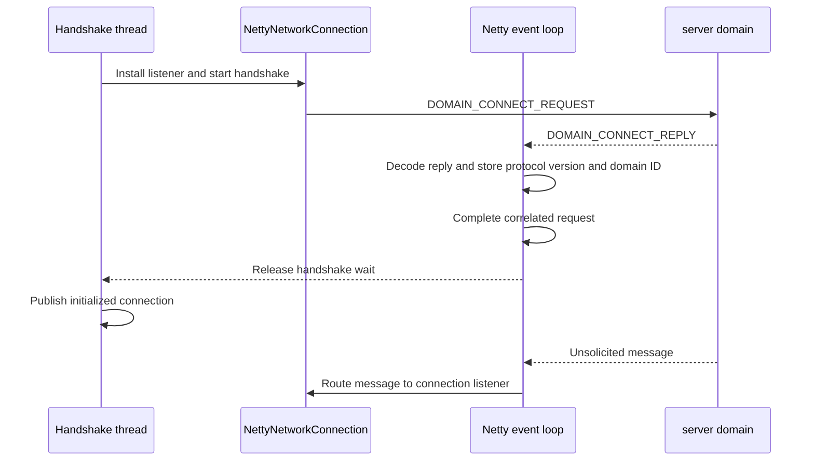

# Outbound handshake

Normal outbound and reverse outbound connections use the same domain-connect handshake after they establish a TCP channel. Normal outbound
opens the channel, while reverse outbound accepts a channel opened by a reverse inbound server.

## Connection establishment

- Normal outbound opens the TCP channel and performs the handshake on the calling thread.
- Reverse outbound accepts the TCP channel and schedules the handshake using an executor, so as not to block the Netty event loop that decodes its handshake reply. The handshake must not block the Netty event
  loop that decodes its reply. After the handshake completes, reverse outbound passes the initialized connection to the configured connection
  consumer, which adds it to a virtual network pool.

## Handshake sequence

The handshake negotiates the protocol version and determines the server's domain ID. Only once the handshake is complete can the newly established connection be used to send new messages 
or potentially receive unsolicited messages e.g. `DOMAIN_DISCOVERY_TOPOLOGY_UPDATE` or `DOMAIN_DISCONNECT_REQUEST`.

1. `NettyNetworkConnection` register a listener to listen for unsolicited messages.
2. `NettyNetworkConnection` sends a `DOMAIN_CONNECT_REQUEST` that contains the supported protocol versions.
3. The server domain selects a protocol version and sends a `DOMAIN_CONNECT_REPLY`.
4. `CasualNWMessageDecoder` decodes the reply and immediately stores the selected protocol version and domain ID in the outbound connection value holders.
5. Because `DOMAIN_CONNECT_REPLY` is a correlated response rather than an unsolicited message, `CasualMessageHandler` passes it to the
   correlator, which completes the handshake request.

For normal outbound, the calling application thread performs the handshake. For reverse outbound, a thread from the configured executor performs it.

## Ordering guarantee

Netty processes inbound events serially for an individual channel. The decoder and message handler therefore finish the connect-reply steps
before the same channel handles a following frame. Other channels can perform their handshakes concurrently without changing this
per-channel ordering.

Storing the negotiated version and domain ID in the decoder lets `NettyNetworkConnection` use one source for each value. The decoder
stores both values before the message handler completes the correlated request. Completing both actions before the correlator releases the
handshake thread prevents a subsequent frame from overtaking connection initialization.

The supported unsolicited messages depend on the negotiated protocol version:

- Version 1.0 does not support unsolicited outbound messages.
- Version 1.1 adds domain-disconnect messages.
- Version 1.2 adds topology-update messages.

## Handshake completion

Normal outbound returns the connection to its caller only after the handshake completes. Reverse outbound adds the accepted connection to its
named network pool only after the same handshake completes. If the handshake fails, the connection closes the channel and does not make the
connection available.
