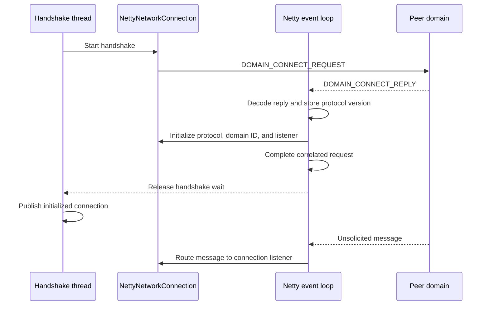

# Outbound handshake

Normal outbound and reverse outbound connections use the same domain-connect handshake after they establish a TCP channel. Normal outbound
opens the channel, while reverse outbound accepts a channel opened by a reverse inbound peer.

## Connection establishment

- Normal outbound opens the TCP channel and performs the handshake on the calling thread.
- Reverse outbound accepts the TCP channel and schedules the handshake on the managed executor. The handshake must not block the Netty event
  loop that decodes its reply. After the handshake completes, reverse outbound passes the initialized connection to the configured connection
  consumer, which adds it to the network pool.

## Handshake sequence

The handshake establishes the peer domain ID and negotiated protocol version before the connection handles unsolicited messages.

1. `NettyNetworkConnection` registers a one-time connect-reply handler with `CasualMessageHandler`.
2. `NettyNetworkConnection` sends a `DOMAIN_CONNECT_REQUEST` that contains the supported protocol versions.
3. The peer selects a protocol version and sends a `DOMAIN_CONNECT_REPLY`.
4. `CasualNWMessageDecoder` decodes the reply and immediately stores the selected version in the channel's `ProtocolVersionValueHolder`.
5. `CasualMessageHandler` invokes the one-time connect-reply handler before it completes the correlated request.
6. The connect-reply handler stores the selected protocol version and peer domain ID in `NettyNetworkConnection`. For protocol version 1.1
   and later, it also registers the connection as the unsolicited-message listener and installs domain-disconnect handling.
7. `CasualMessageHandler` passes the reply to the correlator, which completes the handshake request.
8. The waiting handshake thread resumes and makes the initialized connection available to its consumer.

## Ordering guarantee

Netty processes inbound events serially for an individual channel. The decoder and message handler therefore finish the connect-reply steps
before the same channel handles a following frame. Other channels can perform their handshakes concurrently without changing this
per-channel ordering.

Storing the negotiated version in the decoder lets the decoder validate the next frame. Initializing `NettyNetworkConnection` in the message
handler lets that connection receive the next unsolicited message. Completing both actions before the correlator releases the handshake
thread prevents either frame from overtaking connection initialization.

The supported unsolicited messages depend on the negotiated protocol version:

- Version 1.0 does not support unsolicited outbound messages.
- Version 1.1 adds domain-disconnect messages.
- Version 1.2 adds topology-update messages.

## Handshake completion

Normal outbound returns the connection to its caller only after the handshake completes. Reverse outbound adds the accepted connection to its
named network pool only after the same handshake completes. If the handshake fails, the connection closes the channel and does not make the
connection available.
